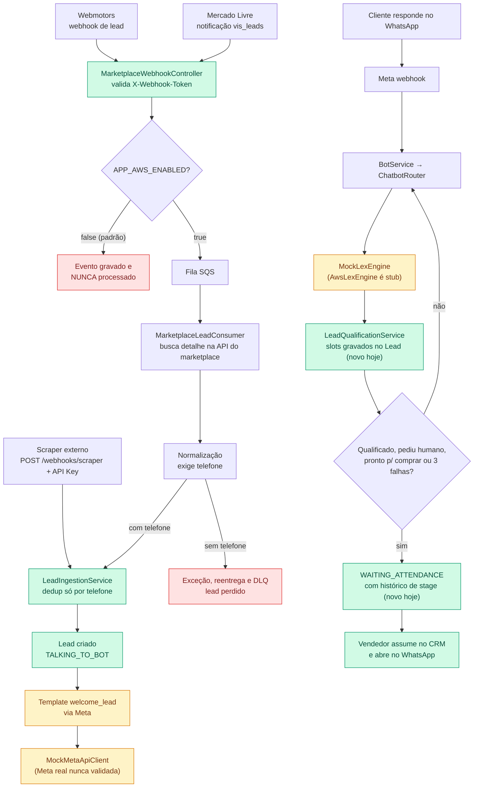
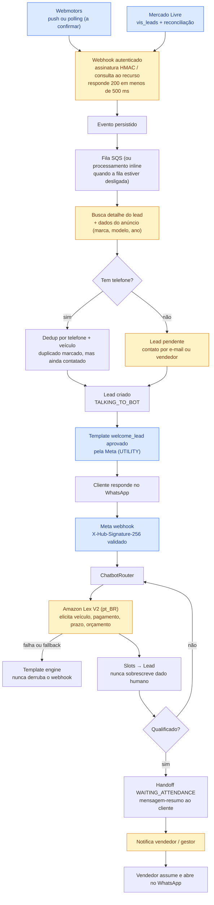
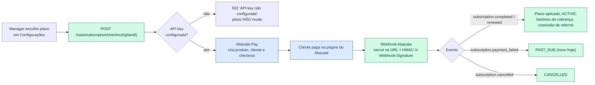
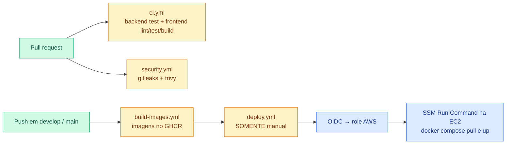

# Astro LeadFlow — Estado atual, gaps e fluxos (2026-11-16)

> Fotografia do projeto após a retomada em 16/11/2026 (o último checkpoint anterior era de 29/04/2026). Os diagramas são Mermaid e renderizam no GitHub e no Obsidian. Legenda de cores: **verde** = funciona e foi verificado, **amarelo** = existe mas é stub/mock/parcial, **vermelho** = gap ou bloqueio, **azul** = depende de ação externa.

## 1. Objetivo (to-be)

CRM SaaS multi-tenant para concessionárias em que **todo lead, de qualquer canal, entra em um único lugar, é qualificado automaticamente e chega ao vendedor visível, rastreável e acionável em segundos**. Os canais do MVP são Webmotors e Mercado Livre. A conversa migra para o WhatsApp (Meta), onde um chatbot (Amazon Lex) qualifica o lead antes do handoff para o vendedor. A cobrança é por assinatura via Abacate Pay.

## 2. Onde estamos

| Módulo | Estado | Observação |
|---|---|---|
| IAM / RBAC | Pronto | Papéis `ASTRO_ADMIN`, `MANAGER`, `SELLER`; referral restrito a `MANAGER` (decidido hoje) |
| CRM (leads, Kanban) | Pronto | Fluxo de stages com timeline |
| Estoque | Pronto | |
| Billing (Abacate Pay) | Pronto em código, **sem teste real** | Checkout, webhook com secret + HMAC, `payment_failed` → `PAST_DUE` (novo hoje); falta chave sandbox |
| Onboarding / Referral / Admin | Pronto | |
| Chatbot (módulo) | Funciona em **mock** | Qualificação grava no `Lead` (novo hoje); `AwsLexEngine` ainda é stub |
| Ingestão de marketplaces | Parcial | Código existe para Webmotors e ML; ver gaps de ingestão |
| WhatsApp (Meta) | **Mock** | Nunca validado contra a Meta real |
| Observabilidade | Pronto | Painel `/admin/system`, regras Prometheus |
| CI/CD | Scaffold em standby | Workflows, Dockerfile do frontend e compose de produção criados, nada executado |
| Perfil de produção | Criado hoje | `application-prod.yml`; boot em produção ainda não testado |

Verificado hoje: frontend com 213 testes, lint sem erros e typecheck limpo; backend `gradlew test` verde (com JDK 21). E2E do Playwright não foi rodado.

## 3. Fluxo do lead: hoje x como deveria ser

### 3.1 Hoje (as-is)

### 3.2 Como deveria funcionar (to-be)

Diferenças-chave: (1) a ingestão não depende de AWS ligada nem perde evento; (2) lead sem telefone não é descartado; (3) o Lex real substitui o mock; (4) o aviso ao vendedor é ativo.

## 4. Fluxo de cobrança (Abacate Pay)

Troca direta de plano (`PATCH /saas/subscription/plan/{id}`) é recusada: o plano só muda após o webhook de pagamento.

## 5. Pipeline de CI/CD (em standby)

Nada disto rodou de verdade: faltam a conta AWS, o repositório com os workflows commitados e um teste do `docker build`.

## 6. Gaps

### Ingestão e marketplaces (detalhes e fontes em `docs/INTEGRACOES-MARKETPLACES-META.md`)

| # | Gap | Gravidade |
|---|---|---|
| 1 | Com `APP_AWS_ENABLED=false`, webhooks de marketplace são gravados e nunca processados | Alta |
| 2 | `X-Webhook-Token` provavelmente não funciona com o ML; com token vazio o endpoint fica aberto | Alta |
| 3 | Webmotors assumido como webhook, mas só se achou API de consulta | Alta |
| 4 | Refresh token do ML é rotativo e de uso único; consumer e job das 3h podem invalidar um ao outro | Média |
| 5 | Lead sem telefone é descartado (vai à DLQ) | Média |
| 6 | ML não preenche marca, modelo e ano | Média |
| 7 | Webhook do ML engole exceções; reconciliação vem desligada por padrão | Média |
| 8 | Credenciais de marketplace em colunas sem criptografia | Média |

### Meta

| # | Gap | Gravidade |
|---|---|---|
| 9 | Nunca validado contra a Meta real; Graph API fixa em v18.0 (a doc cita v24) | Média |
| 10 | `sendTemplate` envia só o nome, sem `components`; `welcome_lead` precisa ser um template sem variáveis | Média |
| 11 | Filtro de assinatura precisa de teste com POST assinado real; chave de replay usa `X-Hub-Delivery`, não confirmado na doc | Média |

### Chatbot

| # | Gap | Estado |
|---|---|---|
| 12 | Slots não chegavam ao `Lead` | **Corrigido hoje** (`LeadQualificationService`) |
| 13 | Handoff não gerava histórico de stage | **Corrigido hoje** |
| 14 | Lead duplicado quebrava o inbound (`Optional` com 2 linhas) | **Corrigido hoje** (usa o mais antigo) |
| 15 | Falha do motor podia derrubar a transação do webhook | **Corrigido hoje** (cai para template) |
| 16 | Fora do horário o lead saía do bot na primeira mensagem | **Corrigido hoje** (bot qualifica 24h) |
| 17 | `AwsLexEngine` e `AwsBedrockEngine` são stubs; bot Lex não existe na AWS; sem IaC | Aberto |
| 18 | Lex não é medido em custo/uso (`AiTokenTracker` ignora tokens zero) | Aberto |
| 19 | Mensagem de handoff fora do horário não avisa "retornamos às 9h" | Aberto |
| 20 | Horário comercial fixo (9–18, todos os dias), sem config por organização | Aberto |

### Produção e deploy

| # | Gap | Estado |
|---|---|---|
| 21 | Faltava perfil de produção | **Criado hoje** (`application-prod.yml`) |
| 22 | O código lê `meta.api.*` e `marketplace.*` sem prefixo `app.`; variáveis como `WEBMOTORS_CLIENT_ID` não chegavam ao código | **Corrigido no perfil prod**; o `application.yaml` base continua sem `marketplace.*` |
| 23 | `EmailService` só tem implementação MailHog; falta SES para convites, onboarding e alertas | Aberto |
| 24 | Segredos em texto puro no compose de desenvolvimento; prod deve usar SSM Parameter Store | Aberto (previsto no README da AWS) |
| 25 | `docker build` do frontend, workflows e boot com perfil `prod` não foram validados | Aberto |
| 26 | Shell com `JAVA_HOME` no Java 11; o projeto exige 21 | Ambiente local |

## 7. Bloqueios (dependem de ação externa)

| Bloqueio | Quem destrava | O que falta |
|---|---|---|
| Meta real | Ruy | Business Portfolio, verificação de negócio, número dedicado, System User com token permanente, template `welcome_lead` aprovado |
| Webmotors | Ruy (contato comercial) | Cadastro do Astro como CRM no Portal, confirmação push x consulta, lista de `idTipoLead`, ambiente de testes |
| Mercado Livre | Ruy | App em developers, redirect URI, assinatura só do tópico `vis_leads`, conta vendedora Motors |
| Concessionária piloto | Ruy | Usuário integrador (Webmotors) e autorização OAuth (ML) |
| Abacate Pay | Ruy | Conta e chave sandbox para o checkout de ponta a ponta |
| Conta AWS | Ruy | Conta com Budget (alertas US$ 50 e US$ 80), OIDC, EC2, SES |

## 8. Dúvidas em aberto

1. A Webmotors entrega leads por push ou só por consulta? Qual formato e autenticação?
2. O ML assina as notificações? Qual header e como se compõe a assinatura?
3. Contatos `question` do ML trazem telefone? Como buscar marca, modelo e ano a partir do `item_id`?
4. A Meta aceita `welcome_lead` como UTILITY, ou reclassifica como MARKETING (mais caro)?
5. Qual o preço de marketing em BRL (rate card oficial)?
6. A v18.0 da Graph API ainda responde?
7. Slot de texto livre do Lex em pt_BR: qual tipo usar para o veículo? (spike previsto no plano do chatbot)
8. Produto: o objetivo é só levar o lead ao WhatsApp, ou também responder dentro do chat de cada marketplace? (decisão atual: levar ao WhatsApp; responder no marketplace fica fora do MVP)

## 9. Próximos passos

| Ordem | Passo | Quem |
|---|---|---|
| 1 | Iniciar verificação de negócio na Meta e submeter `welcome_lead` | Ruy |
| 2 | Contatar a Webmotors e criar o app no Mercado Livre | Ruy |
| 3 | Criar conta e chave sandbox do Abacate Pay; testar checkout de ponta a ponta | Ruy, depois Claude |
| 4 | Gap 1 e 2: processar ingestão inline sem AWS e proteger o webhook do ML | Claude |
| 5 | Gaps 5 e 6: aceitar lead sem telefone e buscar dados do anúncio no ML | Claude |
| 6 | Gap 4: serializar o refresh de token do ML por credencial | Claude |
| 7 | Spike do Lex (tipo de slot de veículo), depois `AwsLexEngine` real com bot em IaC | Claude |
| 8 | Implementação SES do `EmailService` | Claude |
| 9 | Validar `docker build`, rodar workflows num PR e subir o perfil `prod` localmente | Claude |
| 10 | Conta AWS, staging em modo mock, depois ligar Meta e Lex conforme os bloqueios saírem | Ruy e Claude |

## 10. O que mudou hoje (nada foi commitado)

- Fase 14: confirmada como implementada; `subscription.payment_failed` → `PAST_DUE`; referral restrito a `MANAGER`; `STATE.md` e `ROADMAP.md` atualizados.
- Chatbot: `LeadQualificationService`, handoff com histórico, lookup de lead duplicado, fallback de motor, bot qualificando fora do horário, slots canônicos no mock.
- Produção: `application-prod.yml` e ajuste do `.env.example`.
- Scaffold de CI/CD em standby e os documentos de integrações e de plano do chatbot.
- Correção de dois erros de tipo em testes do frontend.
